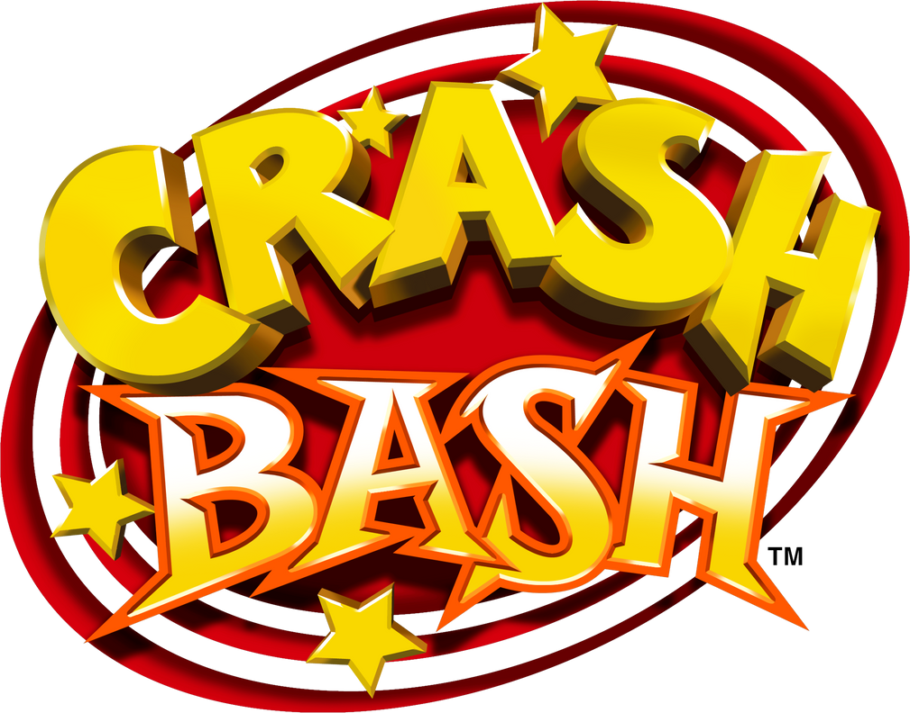

<p align="center">
  
</p>

# Crash Bash: Remaster+ (PC Native Port & Recompilation)

A **native PC port, recompilation, and Remaster+** project for *Crash Bash* (PlayStation 1 — Eurocom, 2000).  
The project aims to modernize the original PlayStation release into a standalone, native Windows/PC executable without relying on traditional emulation. Features include **internal rendering resolutions up to 4K (Ultra HD)**, true **3D Widescreen Hack (16:9 / 21:9)**, **XInput / DualShock Force Feedback (Rumble)**, **Local 4-Player and Online Rollback Netcode**, and a custom pipeline for **High-Poly 3D mesh replacement** and HD textures.

---

## Key Features & Objectives

1. **Native PC Recompilation & Execution:** Direct execution of game code on x86_64 architecture using C decompilation (`mateusfavarin/crashbash`) combined with a high-performance MIPS R3000A / GTE core and a high-level abstraction layer for the Sony Psy-Q SDK (`libgte`, `libgpu`, `libspu`, `libcd`, `libpad`).
2. **Internal High-Resolution Rendering (Up to 4K):** Multi-threaded polygon rasterizer with sub-pixel precision supporting internal scaling factors (1x Native, 2x HD, 3x Super HD, 4x Ultra HD 2048x960), multi-core horizontal band threading, and optional 3D Bilinear Texture Filtering.
3. **True 3D Widescreen Hack (DuckStation Style):** Extended GTE Field of View (FOV) rendering 33% more environment geometry horizontally while preserving original 2D HUD aspect ratios and layout without anamorphic stretching.
4. **Post-Processing GLSL Shaders:** Hot-swappable full-screen shader pipeline including Sharp-Bilinear Pixel-Perfect scaling and authentic CRT Trinitron scanlines.
5. **Modern Native Input & DualShock Vibration:** Full **XInput** support for up to 4 simultaneous gamepads, DualShock 0x73 analog protocol compliance, and dual-motor force feedback (high-frequency buzz and low-frequency rumble) linked directly to Eurocom's internal game actuator state and in-game pause menu options.
6. **Local & Online Multiplayer:**
   - **Local:** Seamless 4-player shared-screen gameplay via standard controllers.
   - **Remote:** Compatibility with *Steam Remote Play Together* and an integrated deterministic **Rollback Netcode** architecture designed for peer-to-peer online play.
7. **Asset Pipeline & Remaster+ Upgrades:** Tooling for unpacking `CRASHBSH.DAT`, exporting original assets (`cb_model2obj`), and an upcoming runtime asset override loader for high-poly 3D models and high-resolution textures.

---

## Project Structure

The repository separates the original reverse-engineered research materials from modern C++ remaster code:

```text
cb/
├── original/                  # 1. ORIGINAL GAME DATA & REFERENCE REPOSITORIES
│   ├── disc/                  # [GIT-IGNORED] Original PS1 disc image (SCUS-94570 / bash.bin)
│   ├── extracted/             # [GIT-IGNORED] Assets extracted from CRASHBSH.DAT
│   └── repos/                 # Cloned research repositories, symbols, and references:
│       ├── crashbash/         # -> mateusfavarin/crashbash (C Decompilation & Symbols)
│       ├── CrashBashEx/       # -> xan1242/CrashBashEx (CRASHBSH.DAT Archive Extractor)
│       └── Crash-Resources/   # -> Helias/Crash-Bandicoot-Resources (File Format Specs)
│
├── remaster/                  # 2. MODERN PC REMASTER+ SOURCE CODE
│   ├── src/
│   │   ├── core/              # Game loop, memory layout, GTE, and Sony Psy-Q SDK shims
│   │   ├── renderer/          # 4K / Widescreen OpenGL backend, rasterizer & shaders
│   │   ├── input/             # Gamepad abstraction: XInput, DualShock rumble & analog sticks
│   │   ├── audio/             # SPU ADPCM decoder, 24-channel audio mixer, and WaveOut
│   │   └── netcode/           # Deterministic state serialization & Rollback Netcode
│   ├── assets_hd/             # Replacement high-poly 3D meshes, HD textures, and shaders
│   └── tools/                 # Build scripts (CMake / MinGW), hash verification, and extractors
│
├── .gitignore                 # Legal compliance: blocks copyright-protected binaries
├── README.md                  # Project overview and instructions
└── ROADMAP.md                 # Detailed milestone roadmap and development progress
```

---

## Legal Notice & Prerequisites (Bring Your Own Game)

To respect copyright, **no copyrighted PlayStation binary files (`bash.bin`, `SCUS_945.70`, `CRASHBSH.DAT`, or audio/texture assets) are distributed with this repository**.

1. You must provide a legally acquired copy of **Crash Bash (NTSC-U Version — `SCUS-94570`)**, which serves as the memory and symbol baseline for this project.
2. Place the disc binary image at `original/disc/bash.bin`.
3. Use the extraction tool (`remaster/tools/cb_extract`) to extract data files into `original/extracted/`.

---

## Building from Source

### Prerequisites
- **Windows 10 / 11**
- **MinGW-w64 (GCC / Clang)** with C++20 support
- **CMake 3.20+**
- **Ninja** or **MinGW Make**

### Compilation
Run the automated build script:
```powershell
powershell -ExecutionPolicy Bypass -File remaster/tools/build.ps1
```
The resulting executables will be placed in `build/`:
- `crashbash_remaster.exe`: Standalone 4K Widescreen Remaster executable.
- `cb_boot.exe`: Headless diagnostic / verification runner.
- `cb_extract.exe`: High-speed `CRASHBSH.DAT` asset extractor.
- `cb_model2obj.exe`: 3D model extractor and OBJ converter.

---

## In-Game Controls & Hotkeys

- **Player 1 Controls:**
  - **D-Pad / Left Stick:** Arrow keys or WASD / Gamepad Left Analog
  - **Cross ($\times$):** `Z` or Gamepad `A`
  - **Square ($\square$):** `X` or Gamepad `X`
  - **Circle ($\bigcirc$):** `C` or Gamepad `B`
  - **Triangle ($\triangle$):** `V` or Gamepad `Y`
  - **Start:** `Enter` or Gamepad `Start`
  - **Select:** `Space` or Gamepad `Back`
- **Graphics & Input Hotkeys:**
  - **`F5`**: Toggle Aspect Ratio (Original 4:3 $\leftrightarrow$ 16:9 3D Widescreen Hack)
  - **`F6`**: Cycle Post-Processing Filter (Sharp 4K $\to$ CRT Scanlines $\to$ Smooth Bilinear)
  - **`F7`**: Cycle Internal Resolution (1x Native $\to$ 2x HD $\to$ 3x Super HD $\to$ 4x Ultra HD 4K)
  - **`F8`**: Toggle 3D Polygon Bilinear Texture Filtering
  - **`F9`**: Cycle Dynamic On-Screen Button Prompts (`Auto` $\to$ `Xbox` $\to$ `PlayStation` $\to$ `Keyboard`)
  - **`F10`**: Toggle On-Screen Prompt HUD Bar (Show / Hide)
  - **`F11`** or **`Alt + Enter`**: Toggle Borderless Fullscreen

---

## Community Credits & Acknowledgements

- **[mateusfavarin/crashbash](https://github.com/mateusfavarin/crashbash):** C decompilation work and symbol mapping for *Crash Bash (PSX)*.
- **[xan1242/CrashBashEx](https://github.com/xan1242/CrashBashEx):** File unpacker and format specifications for `CRASHBSH.DAT`.
- **[Helias/Crash-Bandicoot-Resources](https://github.com/Helias/Crash-Bandicoot-Resources):** Reverse engineering documentation across the *Crash Bandicoot* franchise.
- **[Kenney](https://kenney.nl/assets/input-prompts):** Clean vector Input Prompts asset pack for modern gamepad and keyboard glyphs.
